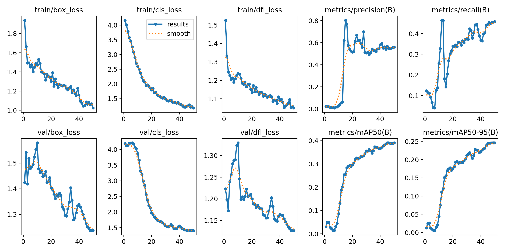

# Architectural-items_detection: detecting doors, windows, furniture, stairs, rooms and walls in floor plans (AECO)

[](https://colab.research.google.com/github/cesaredellacorte-bot/Architectural-items_detection/blob/main/notebooks/02_train_eval.ipynb)

> Author: **Cesare Della Corte** (individual work) · Course: M4U3 · Last updated: 18/10/2026
> Slides: [pdf_pack/slides.pdf](pdf_pack/slides.pdf) · Mini report: [pdf_pack/mini_report.pdf](pdf_pack/mini_report.pdf)
> Docs: [class definitions](docs/class_definitions.md) · [error analysis](docs/error_analysis.md) · [governance checklist](docs/governance_checklist.md) · [SAM notes](docs/sam_notes.md)

## 1. Problem and success criteria
**Problem (AECO):** architectural elements on floor plans (doors, windows, furniture, stairs, rooms, walls) are still counted and marked by hand, for example for quantity take-off, plan review or as-built checks. This project fine-tunes an object detector (**YOLOv8n**) to find these elements in floor-plan images. It is a first step towards a review assistant that pre-marks a plan, which a person then checks. The plans are heterogeneous: scanned, hand-drawn and CAD exports, mostly Finnish residential plans (labels such as KERROS, MH, OH, K).

**Success criteria and result (validation split)**

| Criterion | Target | Result | Met? |
|---|---|---|---|
| Main classes Door and Room: mAP50 | ≥ 0.60 | Door 0.723 · Room 0.740 | ✅ |
| Main classes Door and Room: recall | ≥ 0.60 | Door 0.697 · Room 0.787 | ✅ |
| Window: mAP50 and recall | ≥ 0.60 | 0.425 / 0.433 | ❌ (see error analysis, FN-2) |
| Inference speed on a free Colab T4 | < 0.1 s / image | about 12 ms / image | ✅ |
| Failures understood + a data-improvement plan | 3 FP + 3 FN + 3 actions | [docs/error_analysis.md](docs/error_analysis.md) | ✅ |
| Reproducible: frozen data + hash, one-click notebook | exact same metrics on re-run | reproduced exactly on 2026-10-18 | ✅ |

## 2. Classes and label rules
| ID | Class | Box drawn around | Valid instances |
|---|---|---|---|
| 0 | Door | door leaf + swing arc | 269 |
| 1 | Furniture | one furniture / sanitary / kitchen symbol (**`Furnitures` merged in**) | 270 |
| 2 | Room | inner outline of one enclosed space | 293 |
| 3 | Stairs | the whole stair run incl. landing | 40 |
| 4 | Walls | one straight wall segment (kept, but too rare to learn) | 16 |
| 5 | Window | window symbol across the wall thickness | 247 |

**General rule:** the box is the tightest rectangle around the lines of the element only. No text, dimension lines or surrounding context.
**Duplicate-class fix:** the Roboflow export has 7 names, including `Furnitures`, a typo duplicate of `Furniture` (17 boxes). `scripts/prepare_dataset.py` merges it into `Furniture` (raw id 2 → 1, later ids shift down), converts the 3 polygon rows to boxes and removes duplicates. The frozen zip is never edited, so its hash stays valid. Full rules, include/exclude lists and the id mapping: [docs/class_definitions.md](docs/class_definitions.md).

## 3. Dataset (frozen)
| Item | Value |
|---|---|
| **Frozen copy (used by the notebook)** | GitHub Release [`dataset-v2`](https://github.com/cesaredellacorte-bot/Architectural-items_detection/releases/tag/dataset-v2) → `architectural_items_v2_yolov8.zip` (6.4 MB) |
| **SHA256** | `7e70aedcd900e5e7c4e0b7993dc7d33c736a4eaeeb239296382a768afdb2cb48` (checked by the notebook; it stops on mismatch) |
| Roboflow source | `cesare-della-corte/architectural_items_detection_v1`, **version 2**, exported 2026-09-24, YOLOv8 format (private project; the Release is the public copy) |
| Pre-processing | auto-orient, resize to 640×640 (stretch), no augmentation in the export |
| Split | **train 88 / valid 24 / test 12** images (71 / 19 / 10 %). Test is held out and not used in the reported numbers. |
| Instances (after cleaning) | train 4,008 · valid 1,135 |
| Backup copy | Google Drive file `1iVq3qa_xrTHb422iZmxqrK1AS8E2h0La`, used only if the Release download fails; the notebook warns if its hash differs |
| Origin and rights | about 124 images taken from the public Roboflow Universe dataset [cad-drawings](https://universe.roboflow.com/train-yu3wc/cad-drawings) (MIT). The original labels (door / window / zone) were **not** used: all 6 classes were re-annotated by the author. See Licence below. |

Verify the download yourself: `sha256sum architectural_items_v2_yolov8.zip` (Linux/macOS) or `CertUtil -hashfile architectural_items_v2_yolov8.zip SHA256` (Windows).

## 4. How to reproduce (Google Colab, no local install)
1. Click **Open in Colab** at the top (or open [`notebooks/02_train_eval.ipynb`](https://colab.research.google.com/github/cesaredellacorte-bot/Architectural-items_detection/blob/main/notebooks/02_train_eval.ipynb)).
2. Runtime → Change runtime type → **T4 GPU**.
3. **Runtime → Restart runtime → Run all.** Nothing to edit, no API key, no login.
4. The notebook: installs pinned versions → downloads the Release zip and **checks the SHA256** → merges `Furnitures` → trains 50 epochs → writes the metrics table, curves, evidence images, FP/FN images, `results/run_info.md` and `results/params.yaml` → downloads `results_to_commit.zip`.
5. Runtime: about 1.5 min training + 2-4 min setup on a T4.

**No GPU?** Set `FAST_VERIFY = True` in cell 1. It runs a 5-epoch smoke test, then downloads the released weights (hash-checked) and reproduces the exact metrics below. On CPU this takes about 5 min.
**Weights:** [Release v1.0 → `best.pt`](https://github.com/cesaredellacorte-bot/Architectural-items_detection/releases/tag/v1.0), SHA256 `65b7d90e13729e141e74d8871b8139fb27b51d93822a82c87e24a27876a3b571`.
**Baseline** (pretrained COCO model, no fine-tuning): [`notebooks/01_baseline_inference.ipynb`](notebooks/01_baseline_inference.ipynb).

## 5. Results summary (validation split: 24 images, 1135 instances)

| Class | Precision | Recall | mAP50 | mAP50-95 |
|---|---|---|---|---|
| **ALL** | **0.587** | **0.428** | **0.396** | **0.247** |
| Door | 0.652 | 0.697 | 0.723 | 0.449 |
| Furniture | 0.340 | 0.400 | 0.276 | 0.170 |
| Room | 0.603 | 0.787 | 0.740 | 0.526 |
| Stairs | 0.397 | 0.250 | 0.210 | 0.133 |
| Walls | 1.000* | 0.000 | 0.003 | 0.002 |
| Window | 0.530 | 0.433 | 0.425 | 0.202 |

\* Walls: P = 1.000 is an artefact of (almost) no Walls predictions. The class is not learned.



Evidence: [metrics table](results/metrics.md) · [training curves + confusion matrix](results/curves/) · [10 validation predictions](results/evidence/val_predictions/) · [5 annotation screenshots](results/evidence/annotations/) · [5 predictions on new plans](results/evidence/new_predictions/) · [FP/FN images](results/evidence/errors/)

**Key takeaways**
1. **Large, distinctive objects work:** Room (mAP50 0.740, recall 0.787) and Door (0.723 / 0.697) meet the success criteria.
2. **Furniture has low precision (0.34)** and **Stairs low recall (0.25)**. The error analysis shows that many Furniture "FPs" are real symbols that were never labelled, and that stairs get confused with furniture. Walls (16 boxes) is not learned.
3. **Data-limited, not model-limited:** the curves were still rising at epoch 50 (mAP50 0.36 at epoch 30 → 0.40 at epoch 50). Most misses are small, thin symbols that the 640 px stretch-resize destroys. The next step is better data (label audit, letterbox/tiling, targeted examples), not a bigger model ([3 actions](docs/error_analysis.md#three-prioritised-concrete-data-improvements)).
4. **Use only with a human in the loop:** the model is a pre-marking assistant, not a counting tool ([governance](docs/governance_checklist.md)).

## 6. Reproducibility checklist
- [x] **Dataset frozen:** Release `dataset-v2`, SHA256 `7e70aedc…2cb48`, Roboflow v2, split 88 / 24 / 12, hash checked in the notebook
- [x] **Model variant:** `yolov8n.pt` (YOLOv8 nano, COCO-pretrained)
- [x] **Parameters:** epochs 50 · batch 16 · imgsz 640 · seed 0 · `deterministic=True` · optimizer auto · conf 0.25 / IoU 0.5 for evidence. All in notebook cell 1 and [`results/params.yaml`](results/params.yaml); full Ultralytics args in [`results/curves/args.yaml`](results/curves/args.yaml)
- [x] **Versions pinned:** `ultralytics==8.4.163` in [`requirements.txt`](requirements.txt). Training: Python 3.13.15, torch 2.11.0+cu130, Colab T4 ([`results/run_info.md`](results/run_info.md))
- [x] **Weights:** [Release v1.0 `best.pt`](https://github.com/cesaredellacorte-bot/Architectural-items_detection/releases/tag/v1.0), SHA256 `65b7d90e…a3b571`
- [x] **Notebook opens from GitHub (Open in Colab) and runs end to end** after "Restart runtime → Run all"

### Reproducibility proof
| | Full training run | Independent re-run |
|---|---|---|
| Date | 2026-10-17 | 2026-10-18 20:55 UTC |
| Hardware | Colab Tesla T4 | clean Linux machine, CPU only |
| Mode | full training, 50 epochs (86 s) | `FAST_VERIFY = True` + released weights |
| Dataset hash | — | `7e70aedc…` ✅ matches |
| Result | metrics above | **identical** metrics (mAP50 0.396, mAP50-95 0.247) |
| Runtime | about 2.4 min + setup | 5.2 min |

Details: [`results/run_info.md`](results/run_info.md).

---

### Licence and data rights
- **Code and annotations:** MIT (see [LICENSE](LICENSE)), © Cesare Della Corte.
- **Images:** from one public source, reused under MIT (keep the notice, cite the source):

| Source dataset | URL | Licence |
|---|---|---|
| "cad drawings Dataset" by `train` (Roboflow Universe, Mar 2024) | https://universe.roboflow.com/train-yu3wc/cad-drawings | MIT (per the dataset page, checked 2026-10-16) |

- **Weights:** trained with Ultralytics YOLOv8 (AGPL-3.0); check the obligations before commercial use.
- **Privacy / AI Act:** see [docs/governance_checklist.md](docs/governance_checklist.md).

```
@misc{ cad-drawings_dataset,
  title = { cad drawings Dataset },
  type = { Open Source Dataset },
  author = { train },
  howpublished = { \url{ https://universe.roboflow.com/train-yu3wc/cad-drawings } },
  url = { https://universe.roboflow.com/train-yu3wc/cad-drawings },
  journal = { Roboflow Universe },
  publisher = { Roboflow },
  year = { 2024 },
  month = { mar },
  note = { visited on 2026-10-16 },
}
```
