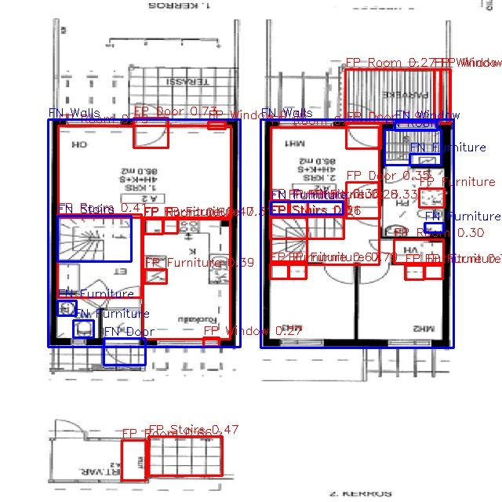
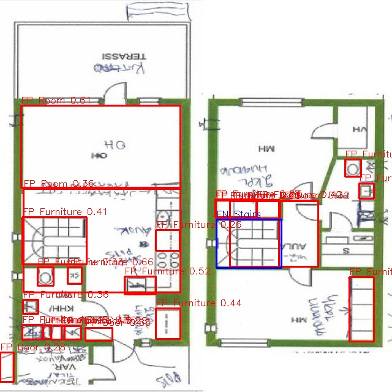
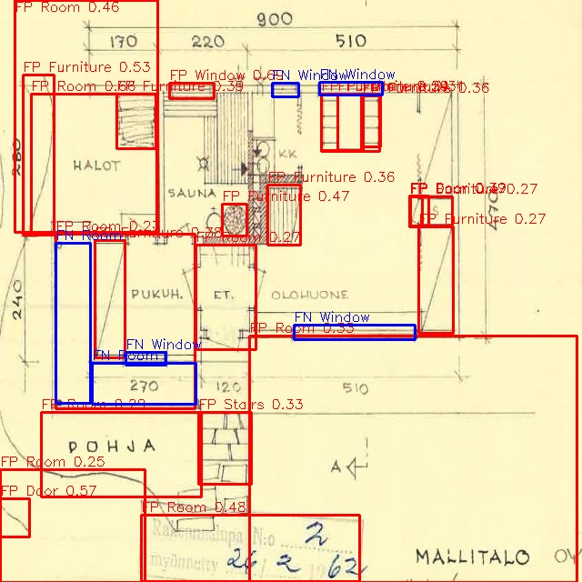
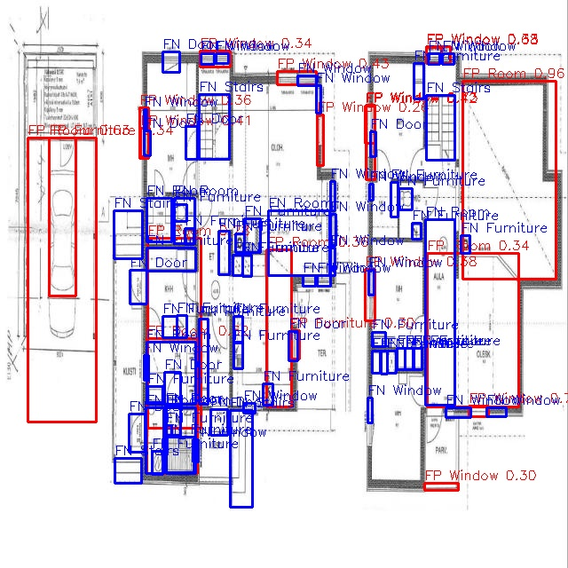
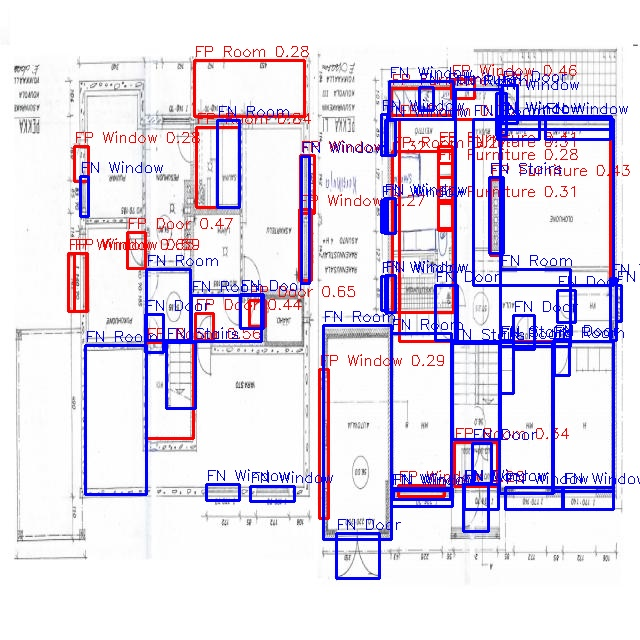
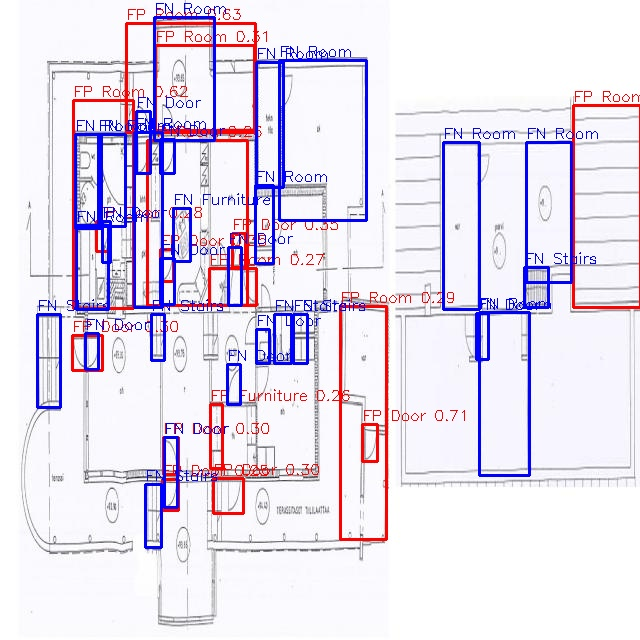

# Error analysis

**Run analysed:** released weights [`best.pt` (v1.0)](https://github.com/cesaredellacorte-bot/Architectural-items_detection/releases/tag/v1.0) (SHA256 `65b7d90e…a3b571`), YOLOv8n, 50 epochs, imgsz 640, seed 0.
**Data:** frozen dataset `dataset-v2` (SHA256 `7e70aedc…2cb48`), validation split: 24 images, 1135 instances.
**Matching rule** (`scripts/evidence.py → find_errors`): confidence ≥ 0.25. A prediction is a TP if it overlaps a ground-truth box **of the same class** with IoU ≥ 0.5; otherwise it is an FP. Every unmatched ground-truth box is an FN. Right place but wrong class therefore counts as **one FP plus one FN**.
**Images:** `results/evidence/errors/` (RED = false positive, BLUE = false negative). They are regenerated by notebook cell 7.

Overall: P 0.587 · R 0.428 · mAP50 0.396 · mAP50-95 0.247. The model misses more than it invents (recall < precision). Most false positives come from **label gaps and look-alike graphics**. Most false negatives come from **small, thin symbols that the 640 px stretch-resize destroys**.

---

## Three false positives (the model predicts something that is not in the ground truth)

### FP-1 · `11358_png_jpg.rf.3bd99770…` — unlabelled fixtures counted as "wrong" Furniture (FP 28 · FN 11 · TP 36)

- **What happens:** about 15 red `Furniture` boxes (conf 0.30-0.70) sit on kitchen counters, the bathroom WC and basin, and the sauna bench of a two-storey Finnish house. Several boxes are stacked on the same counter. One extra `Room` (0.27) is predicted on the balcony (PARVEKE), and `Stairs` (0.47) on the external steps at the bottom.
- **Hypothesis:** many of these are **real furniture symbols that were never labelled**, so a correct detection is scored as an FP. This is a ground-truth gap more than a model error. Labelling style varies between images: some plans have every kitchen unit labelled, others only the big pieces. That explains Furniture's low precision (0.34). The stacked boxes come from a kitchen run being labelled as one box in some images and as single units in others.
- **How to verify:** re-label this image following the class rules and re-run validation. If most red boxes turn green, the cause is the labels.

### FP-2 · `665_png_jpg.rf.a1ebe839…` — stairs predicted as Furniture (FP 23 · FN 1 · TP 23)

- **What happens:** the right-hand staircase (labelled `Stairs`) is detected as **`Furniture` 0.26**, which gives one FP and the single FN in this image. The left staircase also gets `Furniture` 0.41, and it has no Stairs label at all. The remaining FPs are Furniture boxes on kitchen and sanitary symbols, and two `Room` boxes (0.61, 0.36) that split one living area.
- **Hypothesis:** **class confusion Stairs ↔ Furniture.** At 640 px a stair is a rectangle of parallel lines, very much like a kitchen counter, a wardrobe or a sauna bench. With only 113 stair boxes against about 1,040 Furniture boxes in training, the model falls back to the majority class. The unlabelled left staircase is a second label gap. The hand-written notes and green wall fill (a scanned, hand-coloured plan) add a style the model has seen rarely.

### FP-3 · `4831_png_jpg.rf.df1476b3…` — "Rooms" on dimension lines, margins and the permit stamp (FP 24 · FN 6 · TP 9)

- **What happens:** on this old yellowed plan (MALLITALO, 1962), the model draws `Room` boxes (0.25-0.48) along the left **dimension chain** (240 / 280), over empty margins, and over the **building-permit stamp** at the bottom ("Rakennuslupa N:o 2, 26.2.62"). It also predicts a `Door` (0.57) in the bottom-left corner of the page. Only 9 of 33 predictions are correct.
- **Hypothesis:** the model has learned "a large rectangle made of thin lines = Room", and dimension chains, frames and stamps are exactly that. The training set has **no negative examples** of title blocks, stamps or dimension chains (no background images). The same pattern appears in `9782_png_jpg…`: Room 0.48 / 0.50 on the 460 / 540 dimension lines.
- *Side note (`4976_png_jpg…`, FP 27):* here several FPs are **localisation errors**. A door is found, but its box covers only the leaf, not leaf + arc, so IoU < 0.5 and it counts as FP + FN. Door boxes in the labels are not drawn consistently.

---

## Three false negatives (the model misses a real object)

### FN-1 · `499_png_jpg.rf.a66a08bb…` — dense small symbols on a wide two-plan sheet (FN 72 · FP 20 · TP 35; worst image)

- **What is missed:** dozens of `Furniture` (bathroom, kitchen and wardrobe units), most `Window`s, several `Door`s and `Stairs` on both floors.
- **Hypothesis:** the sheet holds **two floor plans side by side plus a garage**, and Roboflow **stretched it to 640×640**. Each symbol ends up only 5-15 px wide, and thin window lines are 1 px or vanish. YOLOv8n at 640 px has little capacity for such small objects. The same cause explains `712_png_jpg…` (FN 34): three floors and a basement on one sheet, CubiCasa style. Stairs and windows there are tiny.

### FN-2 · `5533_png.rf.41d68b78…` — thin windows and doors on a dense scanned plan (FN 48 · FP 23 · TP 38)

- **What is missed:** the outer-wall `Window`s along the right-hand plan (about 20 blue boxes), many `Door`s and `Room`s, and the `Stairs`.
- **Hypothesis:** windows here are 2-3 hair-thin lines **inside a thick wall**, and the scan is grey, low-contrast and covered in blue hand-written notes. Window recall overall is only 0.43, and it is worst on scanned plans. The stretch-resize again shrinks the line spacing to under 2 px, so the window symbol is no longer separable from the wall.

### FN-3 · `5495_png.rf.c48246e4…` — faint grey drawing: Rooms and Stairs missed (FN 28 · FP 16 · TP 20)

- **What is missed:** most `Room`s in the right-hand drawing, and 4 `Stairs` (the narrow stair runs drawn as small hatched strips), plus several `Door`s.
- **Hypothesis:** the drawing uses **very light grey lines on white**, with no black wall fill. Wall outlines, the main cue for Rooms, are barely visible after JPEG compression and resizing. Stairs are drawn in an unusual narrow style (only 40 stair boxes in validation and 113 in training, few in this style). Recall for Stairs is 0.25 overall.

---

## Three prioritised, concrete data improvements

| # | Concrete action (dataset v3) | Fixes | Success measure (same frozen val split) |
|---|---|---|---|
| **1** | **Label audit + rules.** (a) In Roboflow, rename `Furnitures` → `Furniture` (merge). (b) Re-label the **8 worst FP images** found by cell 7 (`1883, 11358, 4976, 4831, 5533, 665, 9656, 9782`) following `docs/class_definitions.md`: add every missing Furniture/Stairs box (for example the left staircase in 665), label kitchen runs per unit, draw Door boxes as leaf + arc. (c) Blur title blocks and stamps (governance). | FP-1, FP-2, FP-3 side note | Furniture precision **0.34 → ≥ 0.50**; Door mAP50-95 **0.45 → ≥ 0.50** |
| **2** | **Stop destroying small objects.** Re-export with **"Fit (letterbox)" instead of "Stretch to 640"**. Add Roboflow **Tile 2×2** preprocessing for sheets with 2+ plans (images like 499, 712, 5533), and train at `imgsz=1024`. Add these as params in cell 1. | FN-1, FN-2 | Window recall **0.43 → ≥ 0.60**; FNs on 499 + 5533 drop from 120 to < 60 |
| **3** | **Targeted examples + negatives.** Add **40-60 stair instances** across styles (spiral, narrow hatched, hand-drawn) and **15-20 faint or yellowed scans** like 5495/4831. Add **10-15 background images** (no labels) of title blocks, permit stamps and dimension chains. Decide on `Walls`: label *every* wall in 30 images, or drop the class (16 val boxes, recall 0). | FN-3, FP-2, FP-3 | Stairs recall **0.25 → ≥ 0.50**; zero Room FPs on stamps and dimension lines in 4831 / 9782 |

**Also:** grow the validation set from 24 to 50+ images, split by source drawing. With 24 images, one image like 499 moves the overall recall by several points.
